# Лабораторная работа №3 — Cloud Networking

**Студент:** Каралащук Илья  
**Группа:** IA2403ru 
**Специальность:** Informatică aplicată  
**Порядковый номер в группе (k):** 7  
**Вариант:** X = 7  
**Уровень:** продвинутый (задания 1–14)  
**Репозиторий приложения:** [\[ссылка на GitHub\]](https://github.com/iliuha-cloud/timecapsule)  
**Регион AWS:** `eu-central-1` (Frankfurt)

## Цель работы

Спроектировать собственную AWS VPC с публичными и приватными подсетями в двух зонах доступности, настроить маршрутизацию и фильтрацию трафика, организовать администрирование через bastion, разместить PostgreSQL в приватной подсети и перенести приложение TimeCapsule из ЛР2 на отдельный сервер с Elastic IP.

## 1. План IP-адресации

По условию `X = k % 30 = 7`. Диапазон VPC — **`10.7.0.0/16`**.

| Подсеть | Зона доступности | CIDR | Первый IP для экземпляра | Последний IP для экземпляра | Доступных IP |
|---|---|---|---|---|---:|
| `public-a` | `eu-central-1a` | `10.7.0.0/24` | `10.7.0.4` | `10.7.0.254` | 251 |
| `public-b` | `eu-central-1b` | `10.7.1.0/24` | `10.7.1.4` | `10.7.1.254` | 251 |
| `private-a` | `eu-central-1a` | `10.7.10.0/24` | `10.7.10.4` | `10.7.10.254` | 251 |
| `private-b` | `eu-central-1b` | `10.7.11.0/24` | `10.7.11.4` | `10.7.11.254` | 251 |

**Почему не 256 адресов?** В `/24` содержится `2^(32−24) = 256` IPv4-адресов. AWS резервирует пять: `.0` — адрес сети, `.1` — маршрутизатор VPC, `.2` — DNS, `.3` — резерв AWS, `.255` — последний адрес подсети. Поэтому экземплярам доступны **251** адрес.

**Сколько ещё `/24` подсетей помещается в VPC?** В `/16` теоретически помещается `2^(24−16) = 256` непересекающихся `/24`; четыре уже запланированы, остаётся **252**. Фактическое создание ограничено квотами AWS.

## 2. VPC и подсети

Создана VPC `timecapsule-dev-vpc` (`10.7.0.0/16`) без IPv6; включены **DNS resolution** и **DNS hostnames**. Созданы четыре подсети из таблицы выше. Для всех ресурсов используются теги `Name`, `Project=timecapsule`, `Environment=dev`, `Owner=ilia-caralasciuc`, `Lab=lab3`.

**Является ли `public-a` публичной сразу после создания?** Нет. Имя подсети не определяет доступность из интернета. Для публичности нужен маршрут `0.0.0.0/0` через Internet Gateway, а для прямого обмена с интернетом экземпляру нужен публичный IPv4 и соответствующие правила доступа.

## 3. Internet Gateway и маршруты

Создан и присоединён к VPC Internet Gateway `timecapsule-dev-igw`.

| Таблица | Привязанные подсети | Назначение | Target |
|---|---|---|---|
| `timecapsule-dev-public-rt` | `public-a`, `public-b` | `10.7.0.0/16` | `local` |
| `timecapsule-dev-public-rt` | `public-a`, `public-b` | `0.0.0.0/0` | `timecapsule-dev-igw` |
| `timecapsule-dev-private-rt` | `private-a`, `private-b` | `10.7.0.0/16` | `local` |

Публичным подсетям включена автоматическая выдача публичных IPv4. В штатном конечном состоянии приватная таблица **не содержит** маршрута `0.0.0.0/0`.

**Контрольные вопросы.** Маршрут `10.7.0.0/16 → local` автоматически существует в обеих таблицах и позволяет обмениваться трафиком внутри VPC. Пакет из `private-a` к `8.8.8.8` без NAT не имеет подходящего маршрута и не покинет VPC.

**Доказательства:**

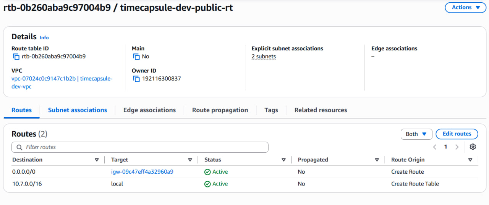

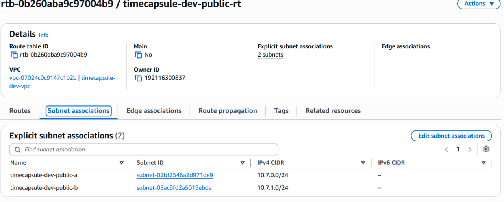

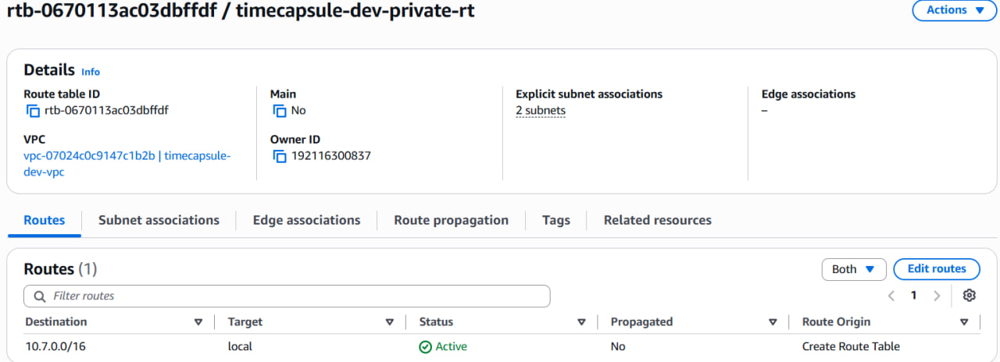

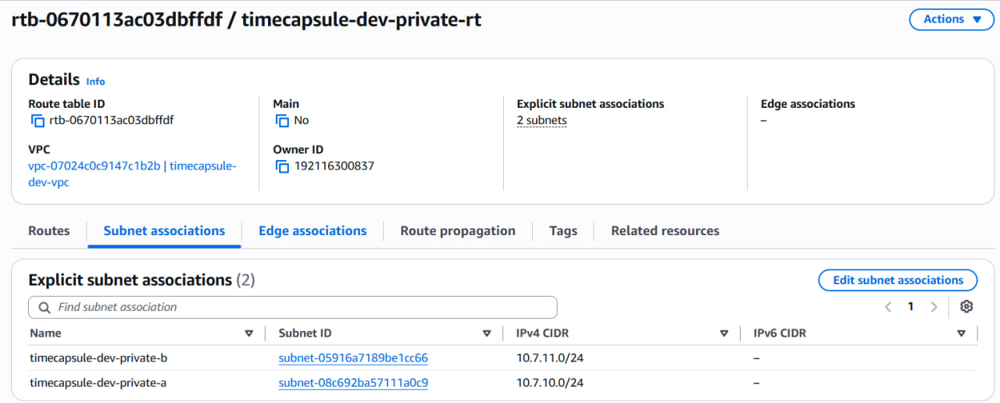

## 4. Security Groups

| Группа | Входящий протокол/порт | Источник | Назначение |
|---|---|---|---|
| `timecapsule-dev-bastion-sg` | TCP/22 | My IP (`/32`) | SSH с компьютера администратора |
| `timecapsule-dev-web-sg` | TCP/80 | `0.0.0.0/0` | HTTP для пользователей |
| `timecapsule-dev-web-sg` | TCP/22 | `bastion-sg` | SSH на web/app-server через bastion |
| `timecapsule-dev-db-sg` | TCP/5432 | `web-sg` | PostgreSQL только от сервера приложения |
| `timecapsule-dev-db-sg` | TCP/22 | `bastion-sg` | SSH к базе через bastion |

Исходящие правила оставлены по умолчанию (All traffic → `0.0.0.0/0`).

**Почему источник `web-sg`, а не IP или вся VPC?** Привязка к Security Group не зависит от изменения приватного IP сервера и ограничивает доступ экземплярами с назначенной группой `web-sg`. Разрешение всей VPC предоставило бы избыточный доступ к PostgreSQL.

**Доказательства:**

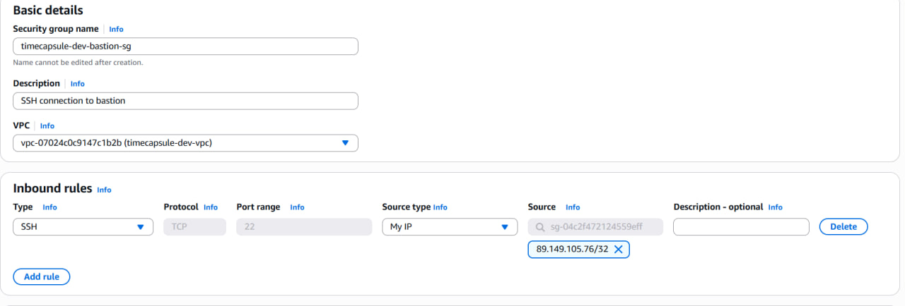

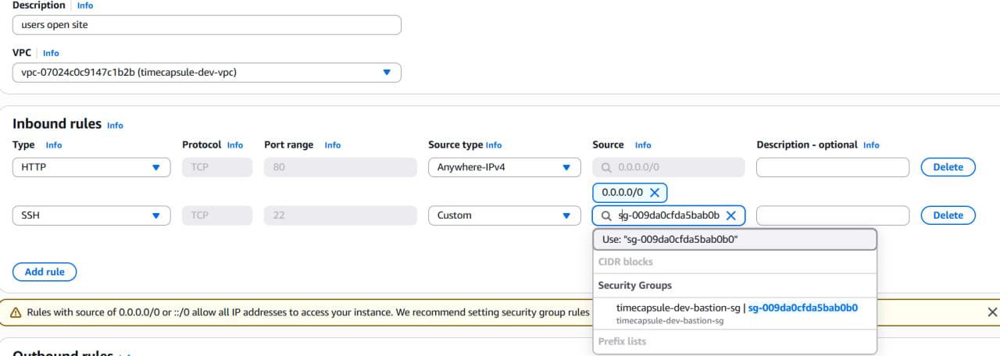

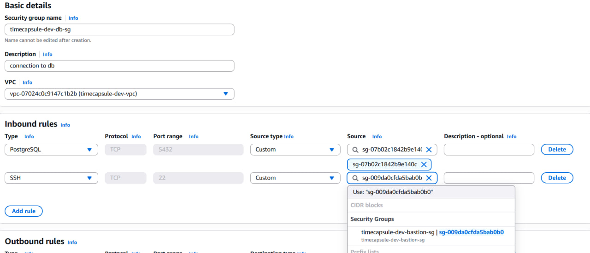

## 5. EC2 и доступ через bastion

| Сервер | Подсеть | Публичный IP | Security Group |
|---|---|---|---|
| `timecapsule-dev-bastion` | `public-b` | Да | `bastion-sg` |
| `timecapsule-dev-web` (Часть 1) | `public-a` | Да | `web-sg` |
| `timecapsule-dev-db` | `private-a` | Нет | `db-sg` |

Все экземпляры: Amazon Linux 2023, `t3.micro`, ключ из ЛР2. На web-server установлен nginx, HTTP-страница отображает имя сервера и его приватный IP. Для SSH используется `ProxyJump bastion`; приватный ключ хранится только на локальном компьютере.

**Почему `dnf install` на db-server не работает без NAT?** Приватная таблица не содержит маршрута к интернету. Web-server использует маршрут через Internet Gateway и публичный IP, а db-server не может обращаться к внешним репозиториям. Для исходящего доступа приватному серверу временно нужен NAT Gateway.

**Доказательства:**

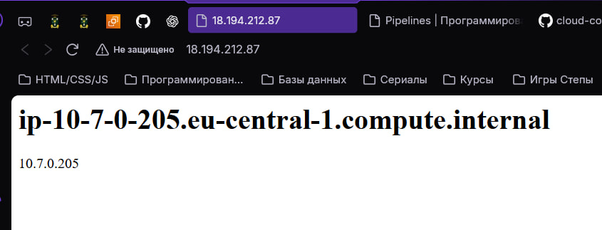

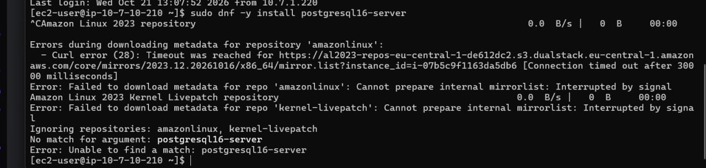

## 6. Временный NAT Gateway и PostgreSQL

Для установки пакетов создан временный публичный NAT Gateway `timecapsule-dev-nat-a` в `public-a`, с Elastic IP `timecapsule-dev-nat-a-eip`. На время установки в `private-rt` добавлен маршрут `0.0.0.0/0 → NAT Gateway`. На db-server установлен PostgreSQL 16, включено прослушивание сетевых интерфейсов, настроен `pg_hba.conf`. После установки NAT Gateway удалён, временный маршрут удалён, его Elastic IP освобождён.

**Какой IP возвращает `curl https://checkip.amazonaws.com` на db-server?** Ожидается публичный Elastic IP NAT Gateway: NAT заменяет исходный приватный адрес db-server своим публичным адресом.

**Три уровня защиты базы:** отсутствие публичного IP и прямого интернет-маршрута препятствует прямому входу из интернета; `db-sg` разрешает TCP/5432 только от `web-sg`; `pg_hba.conf` дополнительно проверяет базу, пользователя, диапазон источника и способ аутентификации. Ошибка в одном уровне ослабляет защиту, но другие уровни могут продолжить блокировать доступ; полагаться только на один механизм нельзя.

**Почему PostgreSQL работает после удаления NAT?** Его локальный процесс и соединения внутри VPC не требуют интернета. Для последующих обновлений безопасности потребуется снова временно организовать исходящий доступ, например повторно создать NAT Gateway и маршрут, затем удалить их.

**Доказательства:**

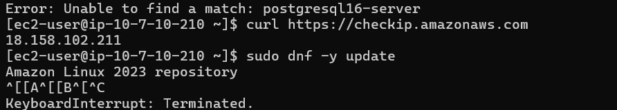

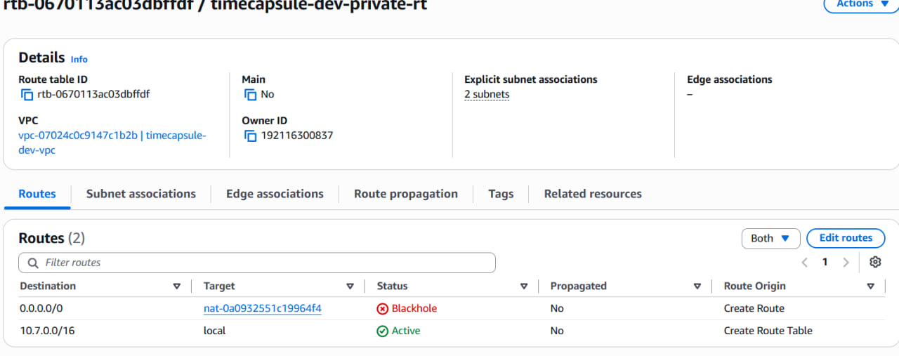

## 7. Проверки сетевой изоляции

| Проверка | Ожидаемый результат |
|---|---|
| `psql` с web-server на приватный IP db-server | Подключение, вывод версии PostgreSQL |
| TCP/5432 с web-server | `open` |
| TCP/5432 с bastion | `closed` |
| `curl -m 5 https://github.com` с db-server после удаления NAT | Тайм-аут / отсутствие доступа |
| Network ACL: Deny 90 с домашнего IP | SSH и сайт с домашней сети недоступны |
| Сайт через мобильный интернет | Доступен |
| После удаления правила Deny 90 | Доступ восстановлен |

**Почему порт 5432 открыт с web, но закрыт с bastion?** Локальный маршрут VPC обеспечивает достижимость IP, но `db-sg` разрешает подключение на 5432 только источникам с `web-sg`; bastion имеет другую группу.

**Можно ли подключиться к db-server:5432 из интернета?** Напрямую нет: у db-server нет публичного IP и прямого входящего пути через Internet Gateway; кроме того, `db-sg` не разрешает внешние источники.

**Почему Network ACL блокирует и SSH, и сайт?** NACL фильтрует трафик на уровне подсети независимо от Security Groups. Правило Deny с номером 90 обрабатывается раньше стандартного Allow 100 и блокирует трафик с указанного домашнего IP; мобильная сеть имеет другой внешний IP и не подпадает под запрет. NACL не хранит состояние соединения.

**Теги.** По `Project=timecapsule` находятся все ресурсы проекта для инвентаризации и последующей очистки. `Owner` указывает ответственного даже в личном аккаунте и полезен при переносе ресурсов или совместной работе.

**Доказательства:**

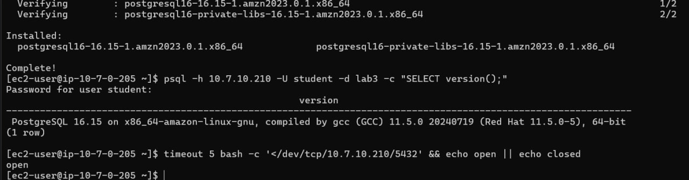

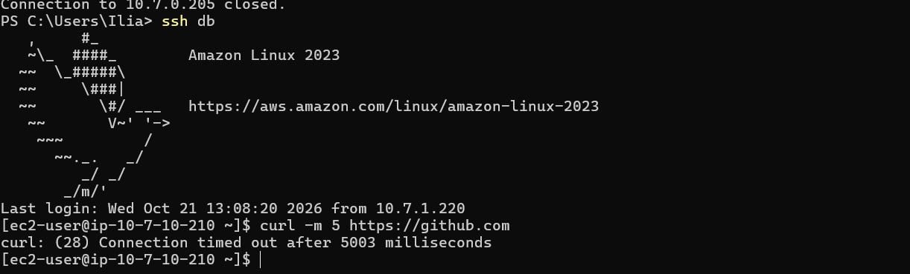

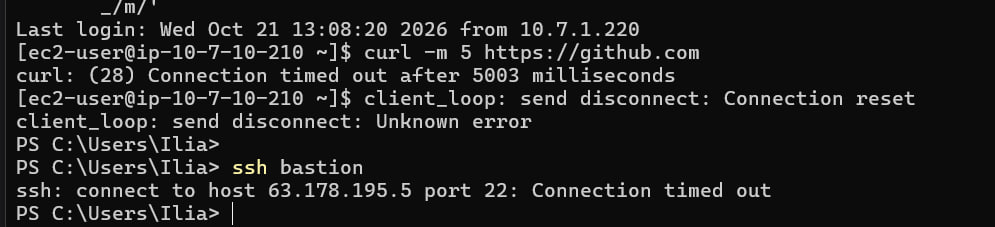

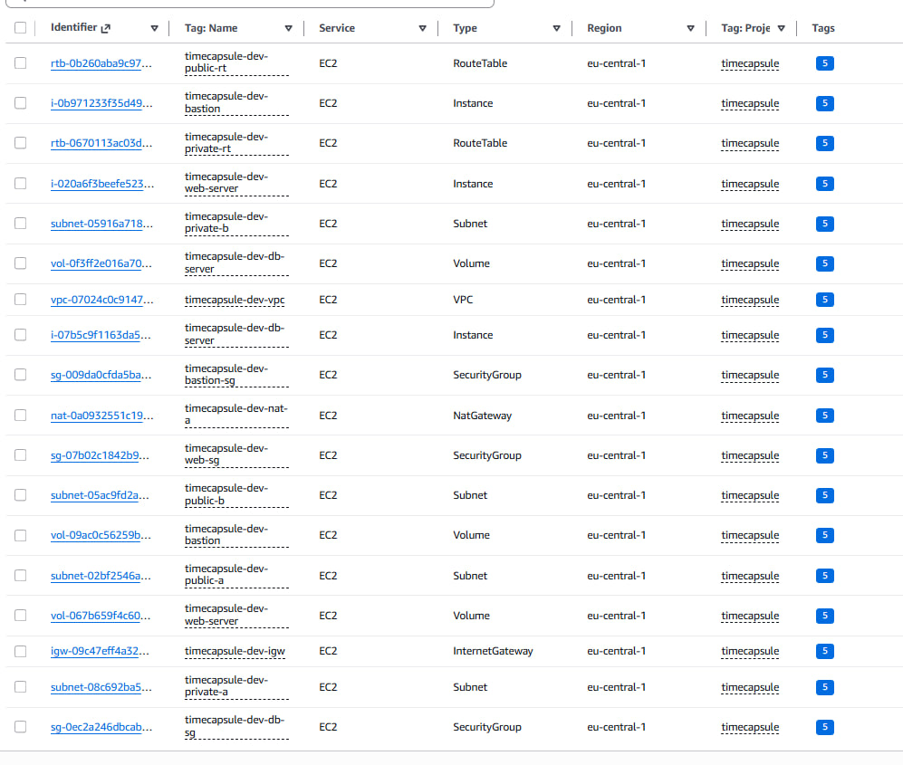

## 8. Перенос приложения из ЛР2

Из экземпляра `webserver` ЛР2 создан AMI `timecapsule-dev-app-lab2`. Из AMI запущен `timecapsule-dev-app` в `public-a` с `web-sg`, после чего тестовый `timecapsule-dev-web` из Части 1 завершён.

**Что содержит AMI?** Снимок системного диска с установленным ПО, кодом TimeCapsule, конфигурацией и локальными файлами, включая данные локального PostgreSQL, если они хранились на включённом в образ EBS-томе. На этом этапе база приложения ещё локальная, пока не выполнен перенос данных и переключение подключения в задании 12.

## 9. Elastic IP приложения

Создан `timecapsule-dev-app-eip`, привязан к app-server. В `/var/www/timecapsule/.env` обновлён `APP_URL=http://52.57.239.107`; применена конфигурация PHP-FPM (и кэш Laravel, если используется).

**Зачем Elastic IP приложению, но не bastion?** Пользователям нужен постоянный адрес сайта, а bastion служит для административного SSH: его изменившийся IP можно обновить в SSH config. Выделенный публичный IPv4 тарифицируется и при остановленном экземпляре (по условиям ЛР — примерно $0,005/час). С балансировщиком нагрузки публичной точкой входа станет балансировщик, и выделенный EIP непосредственно app-server обычно не нужен.

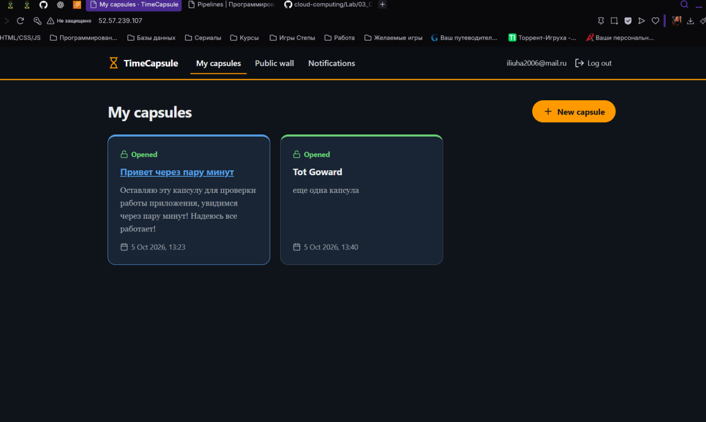

## 10. База приложения на отдельном db-server

Созданы роль PostgreSQL `timecapsule` и база `timecapsule`. Правило `pg_hba.conf` ограничено подключениями к базе `timecapsule` пользователя `timecapsule` из `10.7.0.0/24` с `scram-sha-256`; PostgreSQL перезапущен.

**Почему нужен сильный пароль?** Security Group ограничивает сетевые источники, но не идентифицирует пользователя базы. Если скомпрометирован разрешённый сервер приложения, пароль и права пользователя PostgreSQL становятся дополнительным рубежом защиты.

## 11. Приватный DNS через Route 53

Создана Private Hosted Zone `timecapsule.internal`, связанная с `timecapsule-dev-vpc`, и A-запись `db.timecapsule.internal → [приватный IP db-server]`, TTL 60 секунд.

**Почему имя разрешается внутри VPC, но не на моём компьютере?** Приватная зона Route 53 видна DNS-резолверам связанных VPC и не публикуется в общедоступном DNS. Если db-server пересоздан с новым IP, нужно обновить A-запись.

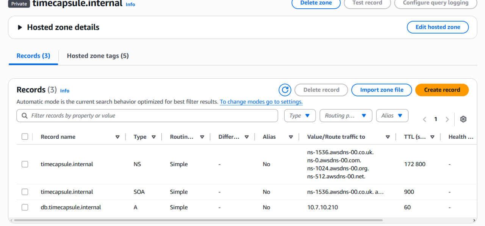

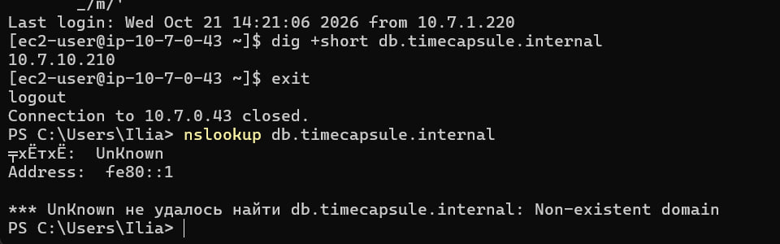

## 12. Перенос данных и переключение приложения

Данные локальной базы ЛР2 экспортированы через `pg_dump`, импортированы в PostgreSQL на db-server через `psql -f`. В `.env` приложения обновлены `DB_HOST=db.timecapsule.internal` и пароль. Конфигурация приложения обновлена; локальный PostgreSQL на app-server отключён. Проверены `/health` и ранее созданные капсулы.

**Где хранятся загруженные файлы?** По схеме ЛР2 — на файловой системе app-server, например `storage/uploads`, на EBS-диске. Они попали на новый сервер через AMI, а не через SQL-дамп. При удалении экземпляра с удалением его EBS-тома файлы будут потеряны, если не перенести их в отдельное хранилище или резервную копию.

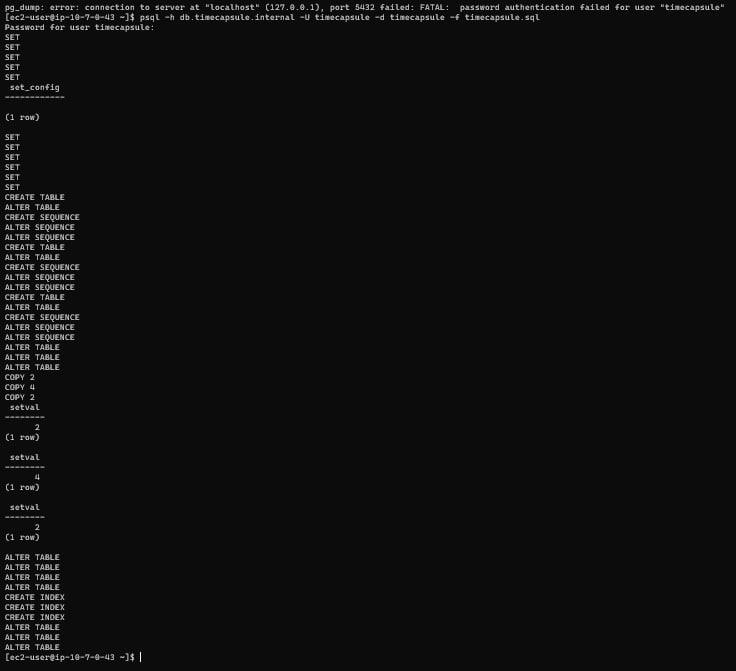

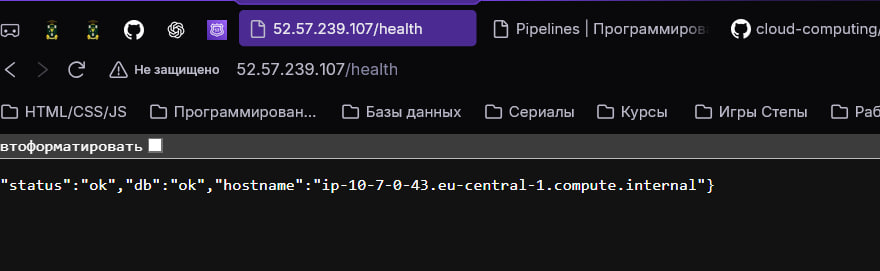

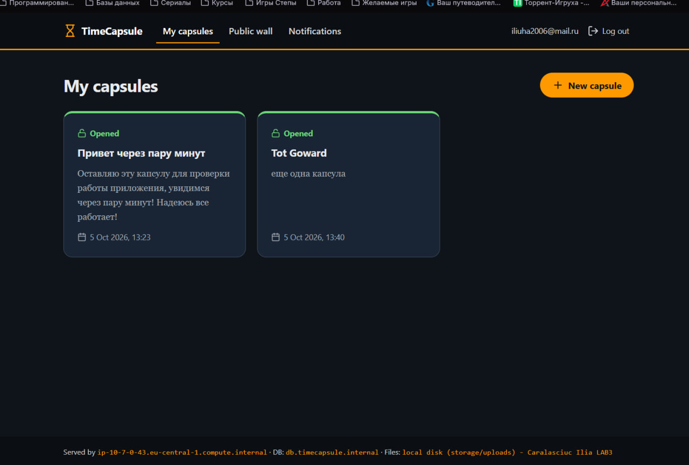

## 13. Деплой и обслуживание

В приложение добавлено видимое изменение `LR3`, изменение отправлено в GitHub и развернуто через SSH/деплой с доступом через bastion.

**Почему deploy.sh не пришлось менять?** `ProxyJump` задан в локальном SSH config, поэтому команда `ssh app` прозрачно подключается через bastion. Сам процесс обновления приложения на целевом сервере остался прежним.

**Отказ базы.** При остановке db-server `/health` должен сообщать об ошибке базы или завершаться ошибкой/тайм-аутом; после запуска доступ восстанавливается. Приватный IP при обычном Stop/Start EC2 сохраняется, поэтому менять DNS-запись не требуется.

**Обновления db-server.** Для установки `dnf update` временно восстановлен NAT Gateway и маршрут. По специальности: Прикладная Информатика - Вариант А - вручную.

**Почему Elastic IP освобождается после удаления NAT?** Пока NAT Gateway использует EIP, адрес связан с ресурсом; освобождение до удаления шлюза невозможно или завершится ошибкой.

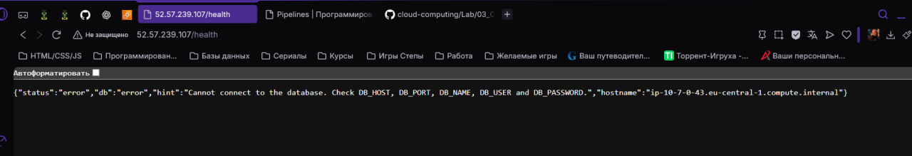

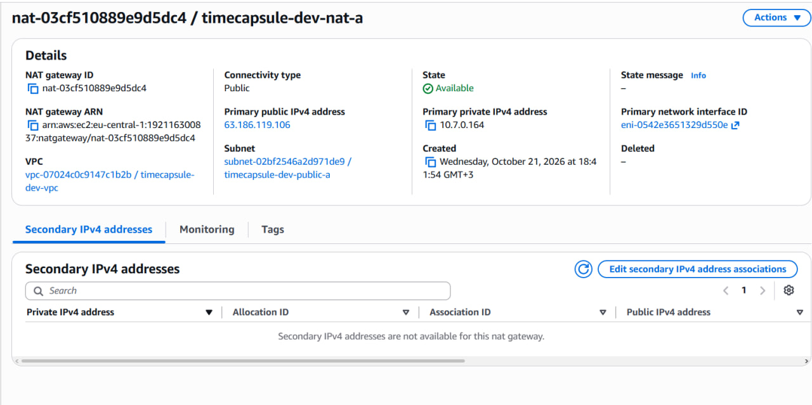
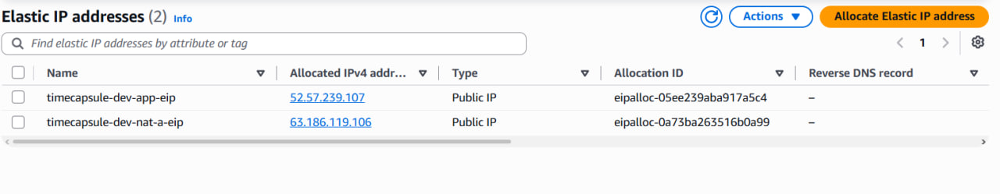

## 14. Архитектура и архитектурное решение

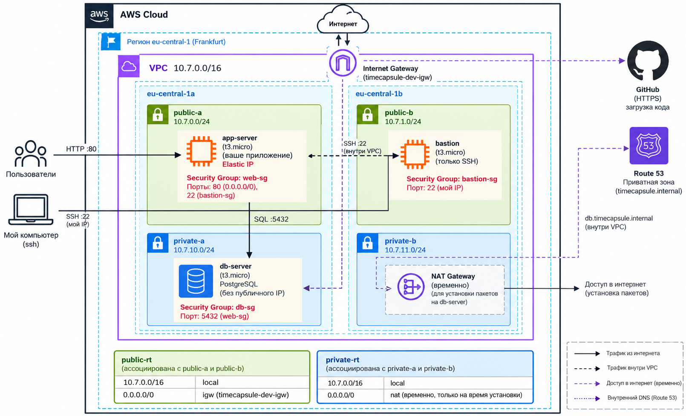

**Примечание:** NAT Gateway и маршрут через него показаны пунктиром как временные ресурсы. После установки обновлений они удаляются. Публичная зона Route 53 не используется: `timecapsule.internal` — приватная зона, привязанная к VPC.

Архитектурное решение по размещению БД: [ADR-0002 — Database Placement](../adr/0002-database-placement.md).

**Сравнение вариантов размещения БД:**

| Вариант | Плюсы | Минусы |
|---|---|---|
| На одном сервере с приложением | Просто, нет отдельного сервера | Общая точка отказа, слабая изоляция |
| Отдельный сервер в публичной подсети | Разделение нагрузки | Лишний риск прямого сетевого доступа |
| Отдельный сервер в приватной подсети | Нет прямого доступа из интернета, точные сетевые правила | Сложнее обслуживание и маршрутизация |

**Принятое решение:** отдельный PostgreSQL-сервер в `private-a`. Обновления устанавливаются через временный NAT Gateway с оплатой времени работы и обработанных данных. Elastic IP закреплён за app-server ради постоянного публичного адреса; при появлении публичного балансировщика точка входа переместится на него.

## Дополнительные контрольные вопросы (продвинутый уровень)

**1. Как проходит запрос от браузера до БД?** Браузер обращается к Elastic IP app-server по HTTP/80 через Internet Gateway и `public-rt`; `web-sg` разрешает входящий HTTP. Приложение обращается к `db.timecapsule.internal`, DNS возвращает приватный IP db-server. SQL-запрос TCP/5432 идёт по локальному маршруту VPC и допускается `db-sg` по источнику `web-sg`, затем проверяется `pg_hba.conf` и пароль PostgreSQL. Ответный трафик возвращается по установленным соединениям.

**2. Если злоумышленник знает приватный IP базы, что ещё ему нужно?** Знания IP недостаточно: нужен разрешённый сетевой путь внутрь VPC и источник, допускаемый `db-sg` (например, компрометированный app-server), а затем подходящие учётные данные PostgreSQL. Прямого входа из интернета нет.

**3. Чем временный NAT лучше постоянного?** Временный NAT уменьшает почасовые расходы и период, когда приватные серверы могут инициировать интернет-соединения. Недостаток — при каждом обновлении нужно создавать шлюз, назначать маршрут, затем корректно удалять маршрут, шлюз и EIP.

**4. Что нужно для переживания отказа `eu-central-1a`?** Нужен дополнительный экземпляр приложения в другой зоне, балансировщик нагрузки с проверками работоспособности и отказоустойчивая база (репликация/автоматическое переключение либо управляемая Multi-AZ БД). Сейчас app-server и db-server размещены в зоне `1a`, поэтому наличие пустых подсетей `1b` само по себе не обеспечивает отказоустойчивость.

## Итоговая проверка и завершение

- [ ] `bastion`, `app-server` и `db-server` остановлены.
- [ ] Тестовый `web-server` из Части 1 завершён.
- [ ] Старый `webserver` из ЛР2 завершён после переноса приложения.
- [ ] Временный NAT Gateway удалён; в `private-rt` нет `Blackhole` и маршрута через NAT.
- [ ] EIP NAT освобождён; EIP app-server сохранён.
- [ ] Временный AMI и его snapshot удалены после успешной миграции.
- [ ] Теги проверены; ключи и пароли не попали в отчёт.

**Вывод.** В ходе лабораторной изучена сегментация AWS VPC на публичные и приватные подсети, маршрутизация через Internet Gateway и временный NAT Gateway, а также фильтрация трафика с помощью Security Groups и Network ACL. Архитектура TimeCapsule предусматривает отдельный app-server с Elastic IP и PostgreSQL в приватной подсети, доступный только по внутренней сети VPC.
