# Лабораторная работа №4 — Amazon S3 и IAM

**Дисциплина:** Cloud Computing  
**Студент:** Каралащук Илья  
**Группа:** IA2403  
**Специальность:** Informatica Aplicata  
**Вариант приложения:** PHP Functional (`src/storage.php`)  
**Уровень:** продвинутый  
**Регион AWS:** `eu-central-1` (Frankfurt)  
**Дата выполнения экспериментов:** 05.11.2026  
**Дата оформления:** 09.11.2026  
**Репозиторий:** https://github.com/iliuha-cloud/timecapsule

> **О достоверности:** отчёт составлен по предоставленным скриншотам, фактическим выводам терминала и описанным действиям. Там, где отдельного подтверждения нет (например, повторные тесты роли после исправления IAM, скачивание PDF под исходным именем и два ответа на отсутствующий объект), это прямо отмечено; результаты не выдуманы. Все 19 изображений включены в каталог `screenshots/` и связаны с этим Markdown-файлом.

## Цель работы и конфигурация

Изучить создание и защиту бакета S3, работу с AWS CLI, HTTPS-only Bucket Policy, версионирование, Lifecycle, подписанные URL, IAM-роли и принцип минимальных привилегий. Перенести вложения TimeCapsule с локального диска EC2 в Amazon S3 и подготовить архитектуру к замене или горизонтальному масштабированию сервера приложения.

| Ресурс        | Конфигурация                              |
|---------------|-------------------------------------------|
| Бакет         | `timecapsule-dev-uploads-iliuha2006`      |
| Префиксы      | `uploads/`, `backups/`                    |
| IAM Policy    | `timecapsule-dev-app-s3`                  |
| Тестовая роль | `timecapsule-dev-s3-tester`               |
| Роль EC2      | `timecapsule-dev-app-role`                |
| Приложение    | `/var/www/timecapsule` на `app-server`    |
| VPC           | `10.7.0.0/16`                             |
| База данных   | PostgreSQL на `db-server`, private subnet |

## Часть 1. Базовый уровень

### Задание 1. Создание бакета и загрузка объектов

Создан бакет `timecapsule-dev-uploads-iliuha2006` в регионе Frankfurt. Используются логические префиксы `uploads/` и `backups/`. По условиям работы заданы ACLs disabled, Block Public Access и SSE-S3; впоследствии включено версионирование. На скриншоте подтверждаются оба префикса, но не все параметры вкладки Properties — для их отдельной проверки нужен дополнительный снимок настроек.

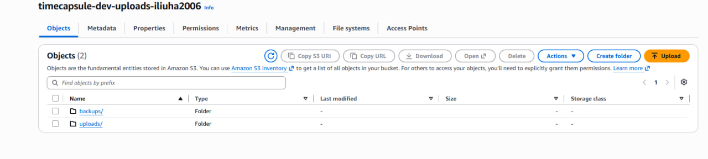

**Ответы.** Ключ объекта — полный путь внутри бакета, например `uploads/photo.txt` или `uploads/lab2_minimax_alpha_beta (1).pdf`. Прямой Object URL недоступен анонимному браузеру из-за Block Public Access и отсутствия публичного разрешения; «Create folder» создаёт префикс (иногда с нулевым объектом-маркером), а не физический каталог.

### Задание 2. Операции с AWS CLI и метаданные

В AWS CloudShell выполнены загрузка `photo.txt`, синхронизация `2026/10/`, листинг бакета, получение метаданных через `head-object`, скачивание файла и удаление тестового объекта. На снимке `head-object` для `uploads/2026/10/report.txt` показывает **`ContentType: text/plain`** и **`ServerSideEncryption: AES256`**.

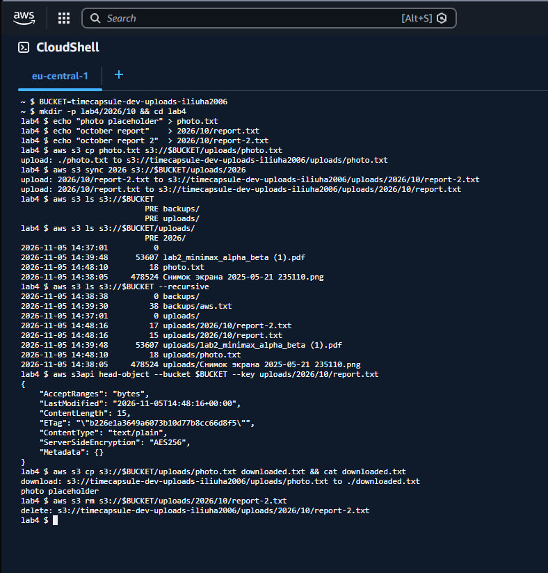

**Сравнение вывода.** `aws s3 ls s3://$BUCKET` показывает `PRE backups/` и `PRE uploads/`; листинг `uploads/` показывает непосредственные объекты и вложенный `PRE 2026/`; `--recursive` отображает полные ключи, включая `uploads/2026/10/report.txt`. Файл `report-2.txt` удалён командой `aws s3 rm`.

**Ответы.** S3 группирует ключи по префиксу, поэтому нерекурсивный список показывает `PRE`, а рекурсивный — полные имена объектов. Для `report.txt` AWS CLI определил тип `text/plain` при загрузке.

### Задание 3. Bucket Policy: только HTTPS

Добавлена ресурсная политика `DenyInsecureTransport`: запрещает `s3:*` для любого Principal при `aws:SecureTransport = false`, охватывает ARN бакета и объектов. Проверка HTTP-endpoint возвращает **`AccessDenied` с explicit deny in a resource-based policy**.

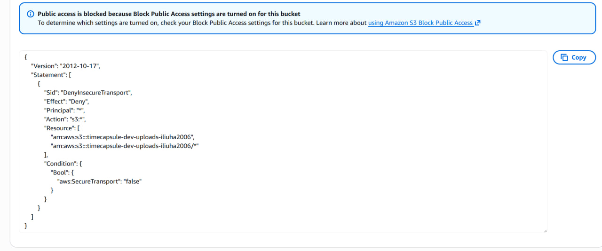

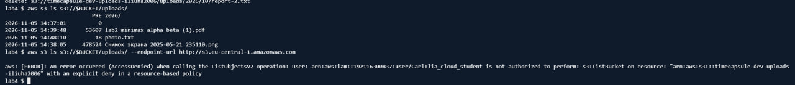

**Ответы.** Явный запрет в Bucket Policy имеет приоритет над IAM-разрешениями, даже если пользователь администратор. `Principal: "*"` здесь относится к запрету, а не к публичному разрешению, поэтому не открывает бакет для всех.

### Задание 4. Версионирование и восстановление

После включения Versioning у старых объектов возможен `Version ID = null`. Для `uploads/notes.txt` созданы последовательные версии; при обычном удалении появился **Delete marker**, а сохранённые версии остались доступны в режиме `Show versions`. На скриншотах показаны маркер удаления и две версии объекта, затем версия `notes.txt` после операций с историей.

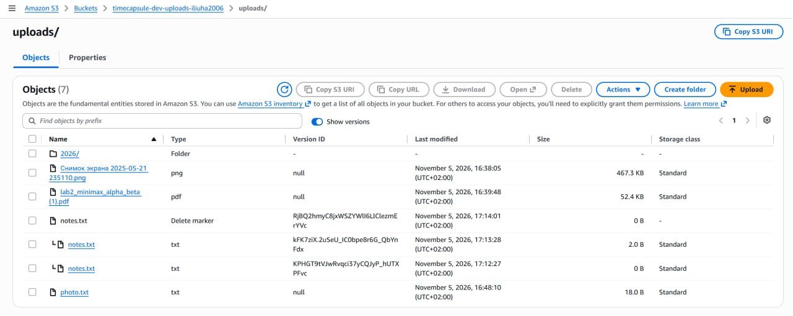

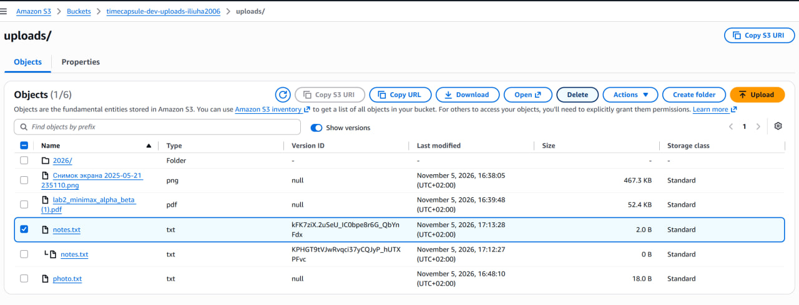

**Ответы.** Обычный `DeleteObject` при включённом Versioning создаёт delete marker, который можно удалить, восстановив видимость предыдущей версии. Удаление конкретного `VersionId` необратимо средствами истории версий; поэтому приложению не выдаётся `s3:DeleteObjectVersion`.

### Задание 5. Lifecycle Rule

Создано правило `timecapsule-dev-noncurrent` с фильтром по префиксу `uploads/`. Итоговый экран настройки подтверждает:

| Действие                                  | Условие                                                     |
|-------------------------------------------|-------------------------------------------------------------|
| Переход неактуальных версий в Standard-IA | Через 30 дней                                               |
| Удаление неактуальных версий              | Через 90 дней, сохраняя две более новые неактуальные версии |
| Abort incomplete multipart uploads        | Через 7 дней                                                |
| Текущие версии                            | Автоматического удаления нет                                |

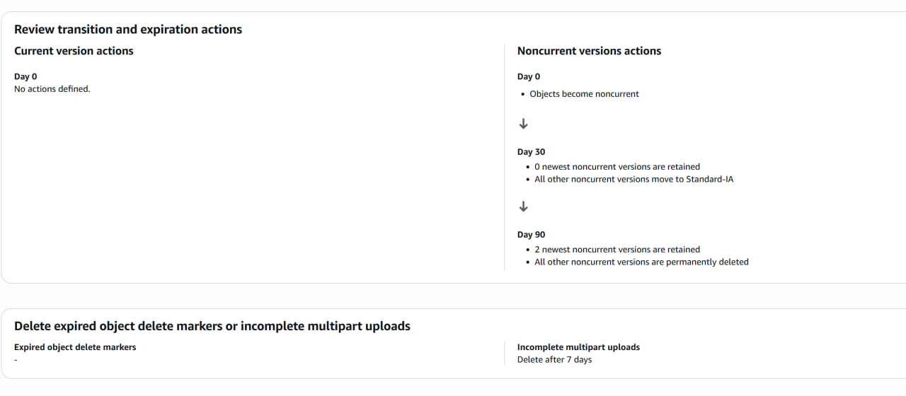

**Ответы.** При многократной перезаписи версии становятся неактуальными, и правило применяет переход/удаление по возрасту с учётом количества сохраняемых версий. Для маленьких объектов автоматический переход в Standard-IA по умолчанию может не выполняться из-за минимального размера 128 КБ. Незавершённая multipart-загрузка занимает место и может тарифицироваться до отмены.

### Задание 6. Presigned URL

Создавалась временная ссылка на объект в S3. Подмена имени объекта в URL привела к **`SignatureDoesNotMatch`**, а открытие после истечения срока — к **`AccessDenied: Request has expired`**. На снимке просроченной ссылки виден параметр `X-Amz-Expires=300`, то есть срок 5 минут; в условии также предусмотрена CLI-ссылка на 120 секунд.

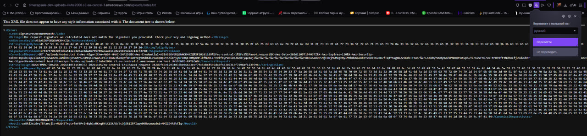

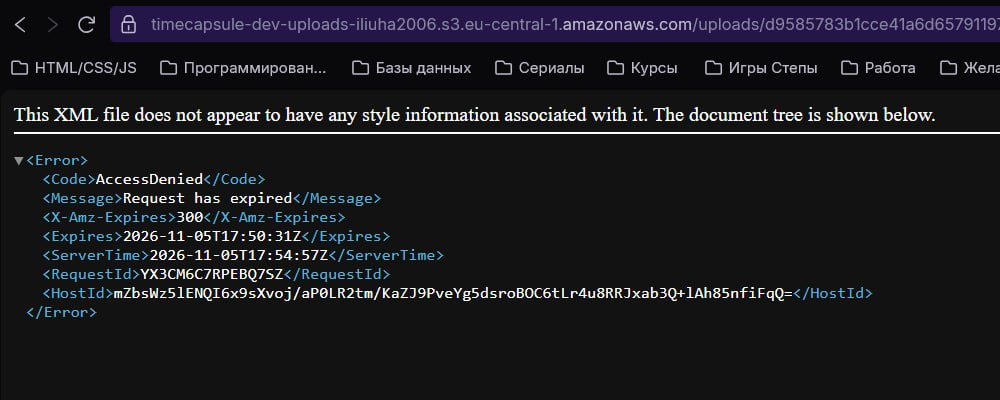

**Ответы.** Подпись привязана к HTTP-запросу, в том числе к ключу объекта, поэтому замена `photo.txt` на `notes.txt` делает её недействительной. После срока `X-Amz-Expires` S3 отказывает в доступе; `aws s3 presign` создаёт подпись на основе имеющихся учётных данных без скачивания объекта.

## Часть 2. Продвинутый уровень

### Задание 7. IAM Policy для приложения

Создана управляемая политика `timecapsule-dev-app-s3`. **При первом создании в ARN остался шаблон `timecapsule-dev-uploads-your-nickname`** — это видно на скриншоте и объясняет первоначальные отказы `AccessDenied` для реального бакета. Впоследствии доступ к `uploads/` на EC2 и синхронизация заработали, что указывает на исправление разрешений до задания 13; отдельного скриншота исправленной версии политики не предоставлено.

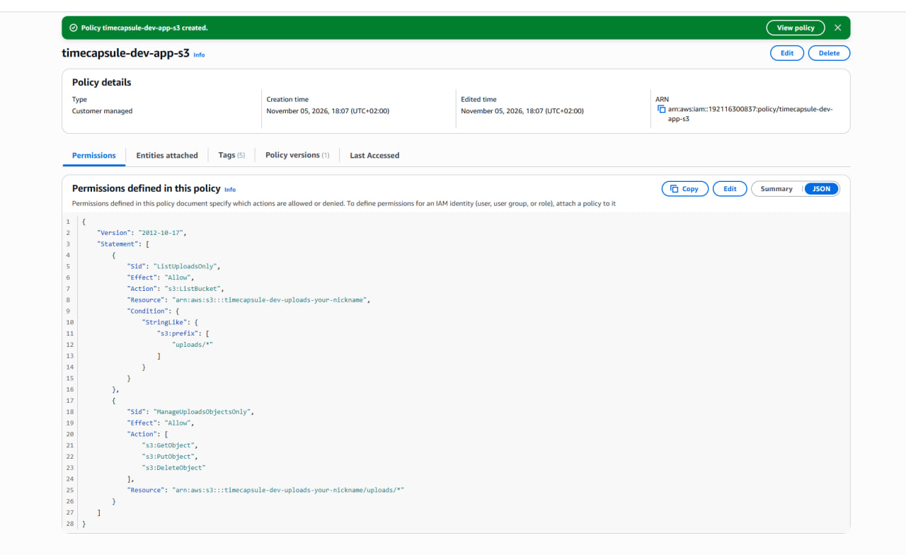

Правильная политика **на этапе заданий 7–12** должна была выглядеть так:

``` json
{
  "Version": "2012-10-17",
  "Statement": [
    {
      "Sid": "ListUploadsOnly",
      "Effect": "Allow",
      "Action": "s3:ListBucket",
      "Resource": "arn:aws:s3:::timecapsule-dev-uploads-iliuha2006",
      "Condition": {"StringLike": {"s3:prefix": ["uploads/*"]}}
    },
    {
      "Sid": "ManageUploadsObjectsOnly",
      "Effect": "Allow",
      "Action": ["s3:GetObject", "s3:PutObject", "s3:DeleteObject"],
      "Resource": "arn:aws:s3:::timecapsule-dev-uploads-iliuha2006/uploads/*"
    }
  ]
}
```

**Ответы.** `ListBucket` применяется к бакету, поскольку перечисляет ключи, а `GetObject`/`PutObject`/`DeleteObject` — к конкретным объектам. Неправильный ARN не соответствует ресурсу запроса, и при отсутствии другого разрешения возникает неявный запрет.

### Задание 8. Тестирование прав через AssumeRole

Тестовая роль `timecapsule-dev-s3-tester` успешно принята в CloudShell: `aws sts get-caller-identity` показала `assumed-role/timecapsule-dev-s3-tester/lab4`.

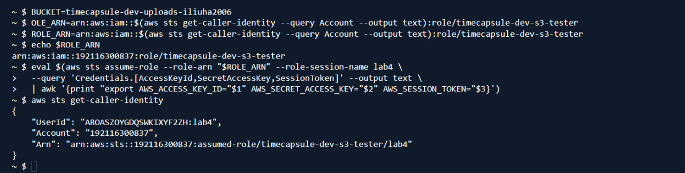

**Таблица тестирования (первый фактически выполненный прогон, до исправления ARN):**

|   № | Операция                                 | Ожидаю         | Получил                               | Сработавшее правило / объяснение                                               |
|----:|------------------------------------------|----------------|---------------------------------------|--------------------------------------------------------------------------------|
|   1 | `cp test.txt → uploads/test.txt`         | Разрешено      | `AccessDenied` (`PutObject`)          | Неявный запрет; неверный ARN в IAM Policy                                      |
|   2 | `ls uploads/`                            | Разрешено      | `AccessDenied` (`ListBucket`)         | Неявный запрет; неверный ARN                                                   |
|   3 | `ls` корня бакета                        | `AccessDenied` | `AccessDenied`                        | Неявный запрет; пустой префикс не разрешён                                     |
|   4 | `cp uploads/photo.txt → stdout`          | Разрешено      | `403 Forbidden` (`HeadObject`)        | Нет эффективного разрешения на объект                                          |
|   5 | `ls backups/`                            | `AccessDenied` | `AccessDenied`                        | Неявный запрет                                                                 |
|   6 | `cp test.txt → backups/test.txt`         | `AccessDenied` | `AccessDenied` (`PutObject`)          | Неявный запрет                                                                 |
|   7 | `list-object-versions --prefix uploads/` | `AccessDenied` | `AccessDenied` (`ListBucketVersions`) | Неявный запрет                                                                 |
|   8 | `delete-object --version-id <VersionId>` | `AccessDenied` | Не выполнено: Bash syntax error       | `<VersionId>` — заполнитель, нужен реальный ID; затем ожидается неявный запрет |
|   9 | `rm uploads/test.txt`                    | Разрешено      | `AccessDenied` (`DeleteObject`)       | Неявный запрет; неверный ARN                                                   |
|  10 | `ls uploads/` через HTTP endpoint        | `AccessDenied` | `AccessDenied` (explicit deny)        | Явный запрет Bucket Policy                                                     |

**Анализ.** Тест подтвердил корректное принятие роли и работу явного HTTPS-only запрета. Первые проверки разрешённых операций не прошли из-за исходной ошибки ARN; повторного полного протокола всех десяти команд после исправления среди приложенных материалов нет, поэтому приписывать им успешный результат нельзя.

**Ответы.** Trust Policy задаёт, кто может принять роль, а Permissions Policy — что разрешено делать после принятия. Обычное удаление создаёт delete marker, но не уничтожает старые версии; отсутствие `DeleteObjectVersion` ограничивает возможность необратимого удаления. Выдача `s3:*` нарушила бы принцип минимальных привилегий.

### Задание 9. Роль EC2

Для `app-server` создана роль `timecapsule-dev-app-role`. На сервере `aws sts get-caller-identity` показала ARN вида `assumed-role/timecapsule-dev-app-role/i-0c4f7dbe3ccd413fc`, то есть CLI получил временные учётные данные от роли EC2. Снимок листинга S3 подтверждает, что до последующего удаления `ListBucket` сервер мог просматривать `uploads/` и видеть новый объект с случайным именем.

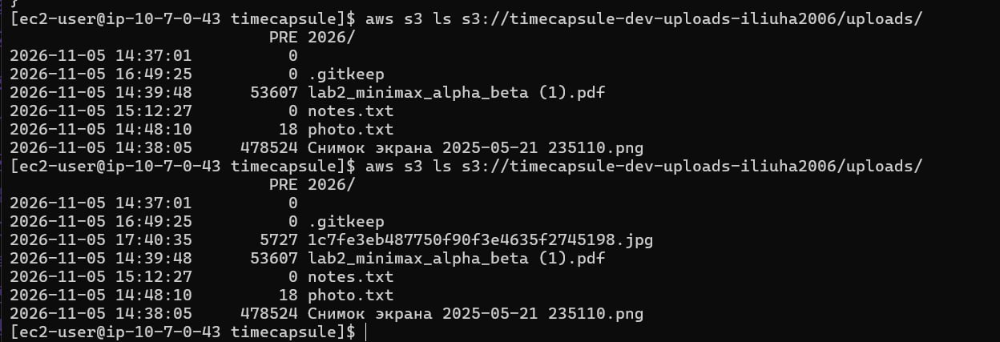

**Ответы.** AWS CLI и SDK получают временные данные через Instance Metadata Service и профиль роли EC2; ручной `aws configure` не нужен. У тестовой роли доверенным субъектом выступает аккаунт, у серверной — сервис EC2. Временные данные безопаснее постоянных ключей в `.env`, поскольку обновляются автоматически и не попадают в репозиторий.

### Задание 10. Перенос вложений в S3

Поскольку приложение находится **в `/var/www/timecapsule` без `current/`**, использовался путь `storage/uploads`. На скриншоте показан цикл `aws s3 sync` с `--dryrun`, реальной загрузкой и повторным `--dryrun`: передана `.gitkeep`, а повторная проверка не показала изменений. Это подтверждает синхронизацию обнаруженных локальных файлов; остальные объекты бакета создавались также на других этапах работы.

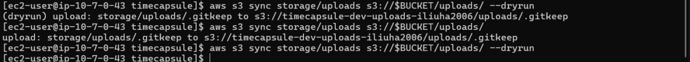

**Ответы.** `sync` требует `s3:ListBucket` для сравнения списка объектов и `s3:PutObject` для загрузки, а для отдельных сценариев может использовать чтение метаданных. После задания 13 `ListBucket` можно убрать из прав веб-приложения, так как SDK работает с известными ключами напрямую.

### Задание 11. Перевод PHP-модуля хранения на S3

Используется **PHP Functional**. Модуль `src/storage.php` адаптирован для AWS SDK for PHP (`aws/aws-sdk-php`), при этом публичный интерфейс функций сохранён:

| Функция            | Реализация                                                                 |
|--------------------|----------------------------------------------------------------------------|
| `storage_save()`   | `putObject` в `uploads/<случайное имя>` с определённым `ContentType`       |
| `storage_delete()` | `deleteObject` по ключу `uploads/<имя>`                                    |
| `storage_stream()` | `GetObject` + `createPresignedRequest('+5 minutes')` + HTTP `302 Location` |

В `.env` сервера добавлены `S3_BUCKET=timecapsule-dev-uploads-iliuha2006` и `AWS_REGION=eu-central-1`. Постоянные AWS-ключи не используются: SDK берёт права у `timecapsule-dev-app-role`. В подвале приложения отображается `Files: timecapsule-dev-uploads-iliuha2006`.

**Ссылка на коммит:** *\[вставить URL коммита с изменениями `src/storage.php`, `composer.json`, `composer.lock`, `.env.example`, `views/layout.php`\]*.

### Задание 12. Деплой и проверка приложения

На скриншоте TimeCapsule доступен через браузер, внизу страницы указано имя S3-бакета. В `uploads/` появился объект `d9585783b1cce41a6d657911973459ad.png`, что подтверждается снимком S3; для другого объекта виден delete marker после удаления. Открытие сохранённой ссылки по истечении пяти минут вернуло `Request has expired` (см. задание 6).

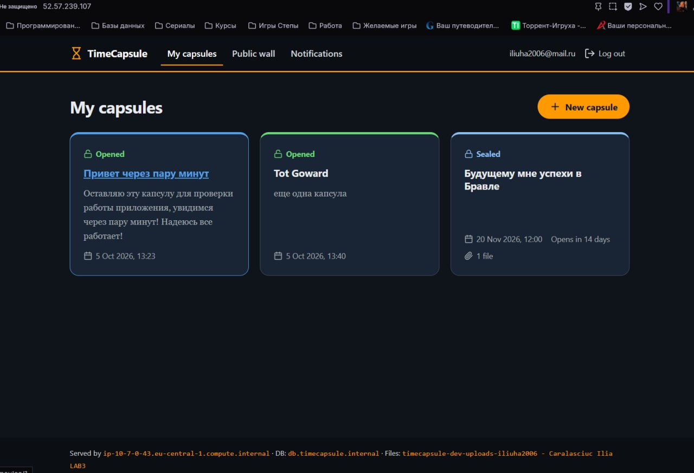

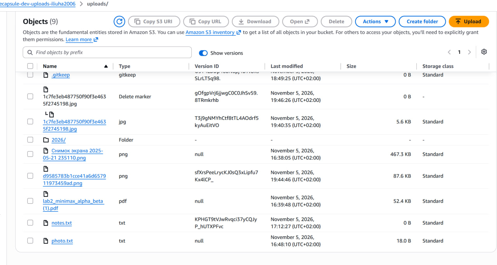

**Проверки:** работа сайта — подтверждена; появление PNG в S3 — подтверждено; истечение подписанной ссылки — подтверждено. **Скачивание PDF под исходным именем, открытие старого вложения и проверка его Content-Type отдельными скриншотами не подтверждены** — эти пункты нужно проверить перед сдачей, если преподаватель требует доказательства каждого шага.

**Ответы.** Переданный другому человеку presigned URL перестанет работать по истечении срока, хотя до истечения его может открыть любой обладатель ссылки. При удалении объекта в версионируемом бакете появляется delete marker, а прежние версии сохраняются до удаления конкретной версии или обработки Lifecycle.

### Задание 13. Сервер без локальных вложений

На EC2 перемещена папка `/var/www/timecapsule/storage/uploads` в `/home/ec2-user/uploads-backup`; последующая команда `ls` подтвердила отсутствие исходного каталога. В резервной папке на момент перемещения находился `.gitkeep`. После уменьшения IAM-политики роль EC2 стала получать `AccessDenied` на `s3:ListBucket` для `uploads/` и `backups/` — это **ожидаемый результат** принципа минимальных привилегий.

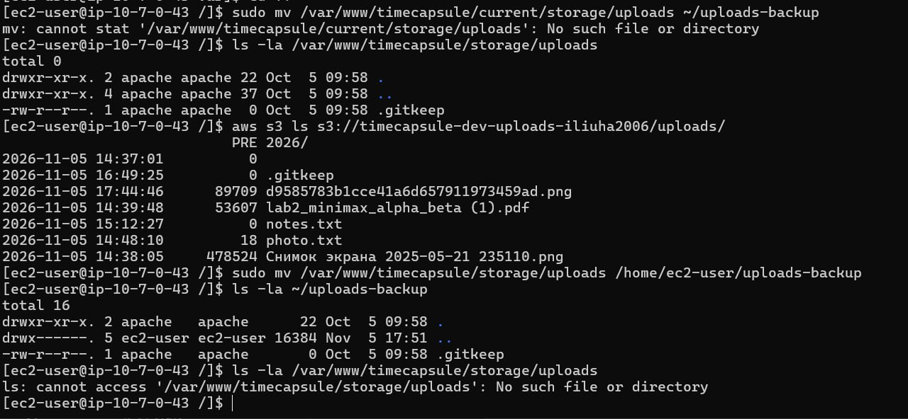

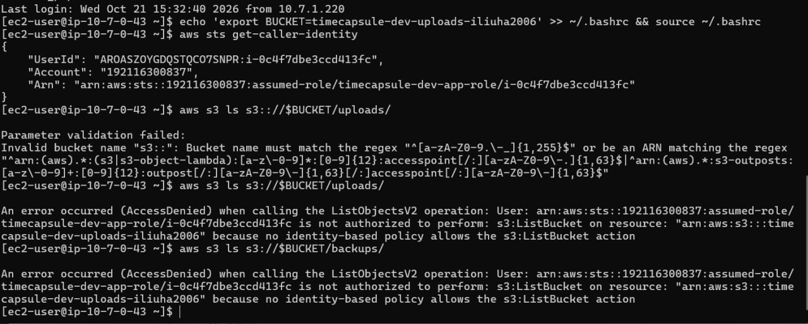

Финальная политика приложения после удаления `ListBucket` должна содержать только действия над объектами:

``` json
{
  "Version": "2012-10-17",
  "Statement": [{
    "Sid": "ManageUploadsObjectsOnly",
    "Effect": "Allow",
    "Action": ["s3:GetObject", "s3:PutObject", "s3:DeleteObject"],
    "Resource": "arn:aws:s3:::timecapsule-dev-uploads-iliuha2006/uploads/*"
  }]
}
```

**Ограничение подтверждений:** скриншот сайта показывает его доступность, но не доказывает отдельно, что все старые вложения открывались *после* переноса папки. Результаты двух команд `aws s3 cp .../no-such-file.txt -` на EC2 и в CloudShell не приложены.

**Ответы.** Без `ListBucket` запрос несуществующего ключа через S3 часто возвращает **403**, тогда как субъект с `ListBucket` может получить **404**; это не раскрывает неавторизованному клиенту факт существования объекта. Для замены `app-server` достаточно развернуть код и конфигурацию на новом EC2 с той же IAM-ролью и доступом к базе: вложения уже не привязаны к локальному диску.

### Задание 14. Архитектура и ADR

Исходная архитектура ЛР3: VPC `10.7.0.0/16`, `app-server` и bastion в публичных подсетях, `db-server` в приватной, Route 53 Private Hosted Zone, Internet Gateway и временный NAT Gateway. В ЛР4 вложения перенесены в Amazon S3, который является региональным сервисом **вне VPC**.

**Схема ЛР3 (до переноса вложений):**

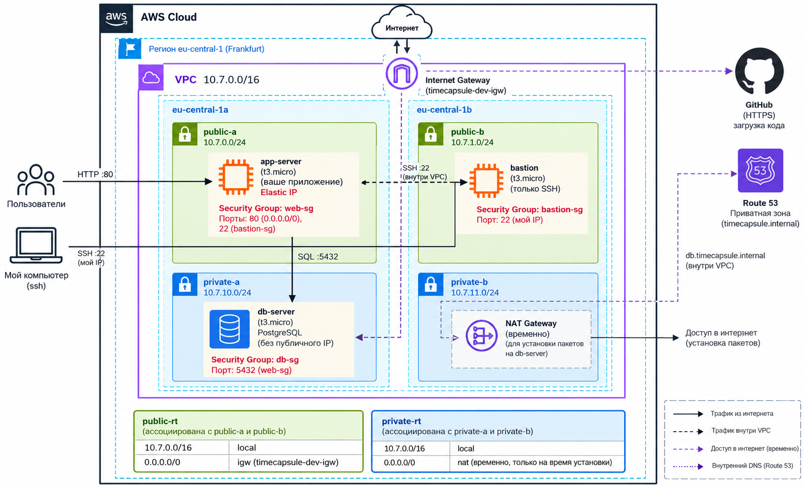

**Предоставленная обновлённая иллюстрация ЛР4:**

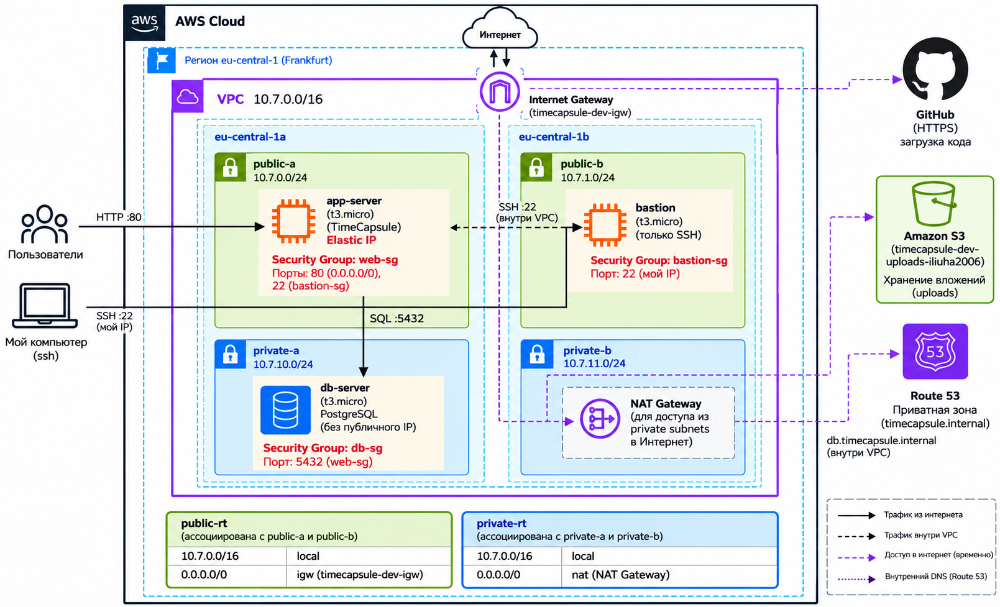

> **Уточнение к иллюстрации:** на предоставленном PNG роль EC2 и два обязательных потока к S3 не подписаны отдельно, а бакет нарисован за внешней рамкой региона. Корректное логическое размещение и необходимые стрелки показаны ниже: S3 — в `eu-central-1`, но за границей VPC. Это уточнение важно для строгого соответствия пункту 14.

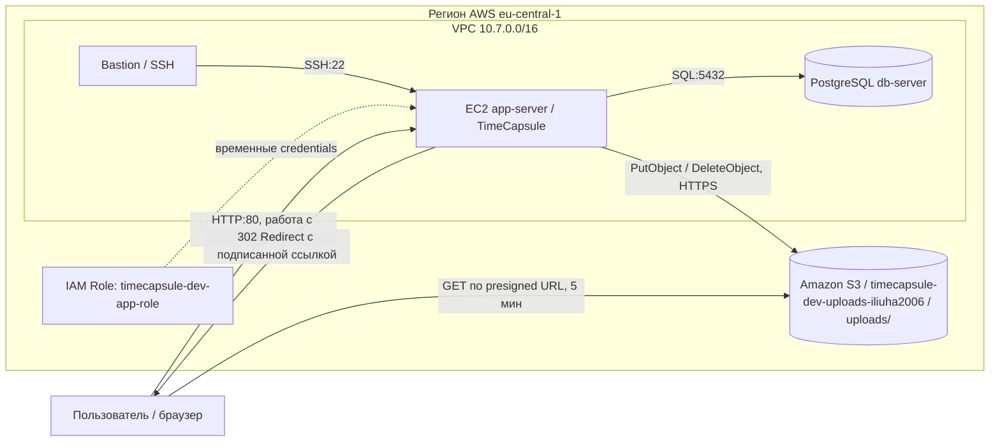

**Архитектурное решение:** [ADR-0003 — Хранение вложений в Amazon S3](../adr/0003-attachment-storage.md). Сравниваются EBS, EFS и S3; описаны последствия для стоимости, отказоустойчивости, срока URL и масштабирования.

## Итоговый вывод

В лабораторной создан приватный S3-бакет, настроены HTTPS-only Bucket Policy, версионирование и Lifecycle, проверены ошибки изменённой и просроченной подписанных ссылок. Настроены IAM-роли, приложение PHP Functional переведено на S3, а локальный каталог вложений вынесен из каталога приложения. Первоначальная ошибка ARN в IAM Policy была обнаружена по `AccessDenied`; позднее сервер получил доступ к S3, а после сокращения прав `ListBucket` снова стал ожидаемо запрещён. Для полного доказательства всех критериев остаётся приложить отдельные проверки PDF, старых вложений, отсутствующего объекта и полный повтор тестов задания 8 после исправления политики.

**Безопасность:** в отчёт не включены AWS Access Key, Secret Access Key или Session Token. Сроки опубликованных на скриншотах подписанных ссылок уже истекли.
