# Лабораторная работа №5. Облачные базы данных. Amazon RDS

|  |  |
|---|---|
| **ФИО** | Каралащук Илья |
| **Группа** | IA2403 |
| **Специальность** | Informatica Aplicata |
| **Уровень** | Продвинутый (задания 1-12) |
| **Репозиторий** | https://github.com/iliuha-cloud/timecapsule |

---

# Базовый уровень

## Задания 1-3. Группа подсетей, доступ к базе, подключение

**Группа подсетей `lab5-db-subnets`** создана в VPC из ЛР3 (`private-a`, `private-b`), статус *Complete*:

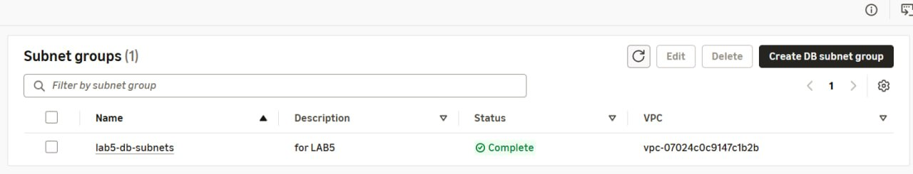

**Как ограничен доступ к базе.** База `lab5-db` размещена в приватной подсети без публичного доступа. Security Group `lab5-rds-sg` содержит единственное входящее правило: PostgreSQL, TCP 5432. Источником правила указана Security Group веб-сервера (а не IP-адрес или `0.0.0.0/0`):

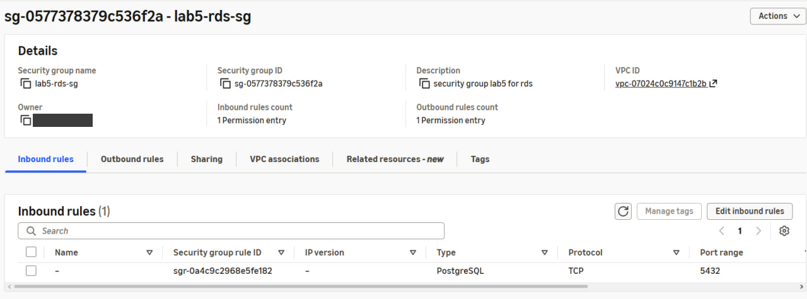

**Подключение с веб-сервера** и `\conninfo`: соединение установлено по TLS 1.3, адрес базы `10.7.10.131` (приватная подсеть `private-a`), пользователь `dbadmin`, база `lab5`:

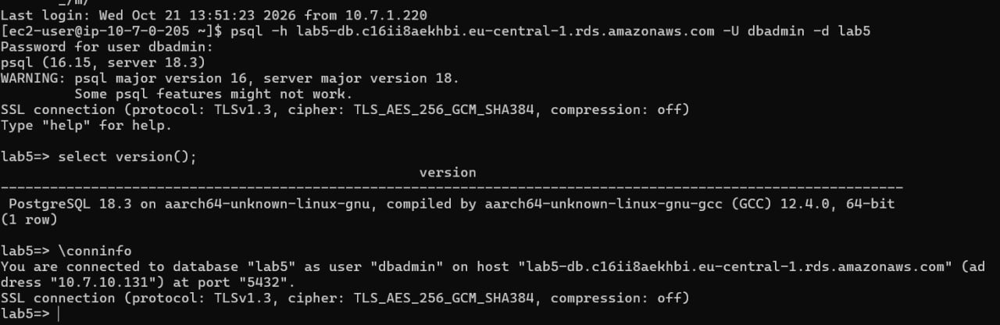

**Таблица `notes` и IP-адрес базы.** Таблица создана, `SELECT * FROM notes` возвращает три строки. Имя endpoint на сервере приложения (резолвер VPC `10.7.0.2`) и на моём компьютере разрешается в один и тот же **приватный** адрес `10.7.10.131`, поэтому с моего компьютера к базе подключиться нельзя:

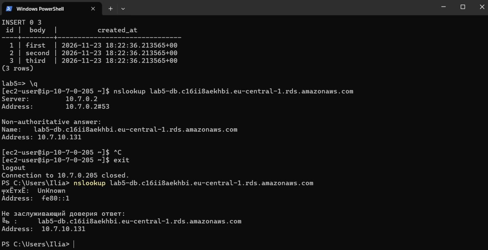

**Проверки доступа:**

- с веб-сервера (его Security Group указана в правиле) подключение успешно (скриншот выше);
- адрес базы приватный (`10.7.10.131`), публичного IP нет, поэтому из интернета и с моего компьютера база недоступна;
- в Security Group базы нет других правил, кроме 5432 от Security Group веб-сервера.

## Задания 4-5. Реплика для чтения и восстановление

**Реплика `lab5-db-replica`** (зона `eu-central-1b`). На реплике `pg_is_in_recovery()` возвращает `t`, `SELECT` работает (три строки), а `INSERT` завершается ошибкой `cannot execute INSERT in a read-only transaction`. (Первая попытка с опечаткой `ps_is_in_recovery` дала `function does not exist`, вторая выполнена правильно.)

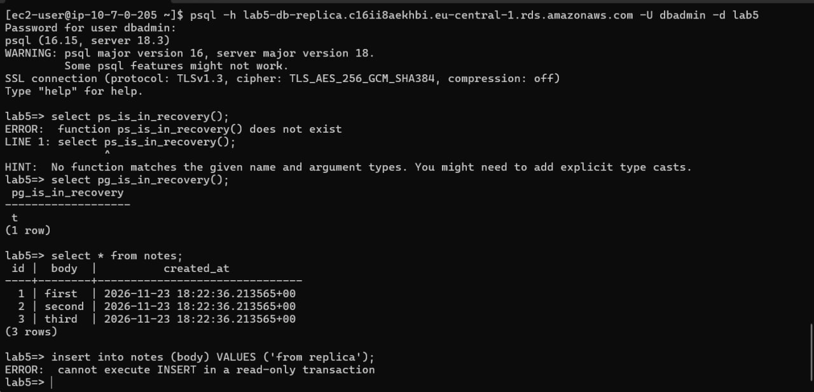

**Основная база и строка `fourth`.** На основной базе `pg_is_in_recovery()` возвращает `f`, `INSERT ... ('fourth')` выполнен. После повторного подключения к реплике в таблице `notes` уже 4 строки, включая `fourth`:

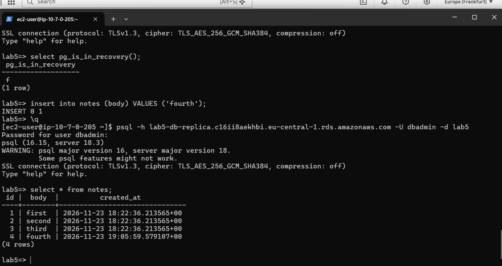

**Метрика ReplicaLag** (вкладка Monitoring): отставание реплики порядка 47-55 секунд, значение снижается:

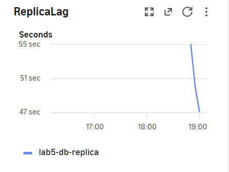

**Восстановление после ошибки.**

Шаг 1. Время для восстановления на основной базе: `2026-11-23 19:12:15 UTC`:

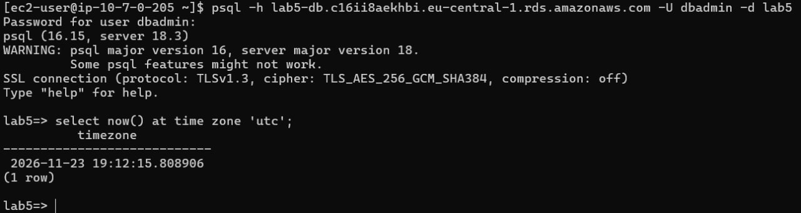

Шаги 2-3. После `DELETE FROM notes;` таблица пуста (0 строк), реплика тоже повторила удаление. Затем реплика удалена, база восстановлена на момент `19:12:15 UTC` в новую базу `lab5-db-restore`. В восстановленной копии снова 4 строки (`first`, `second`, `third`, `fourth`):

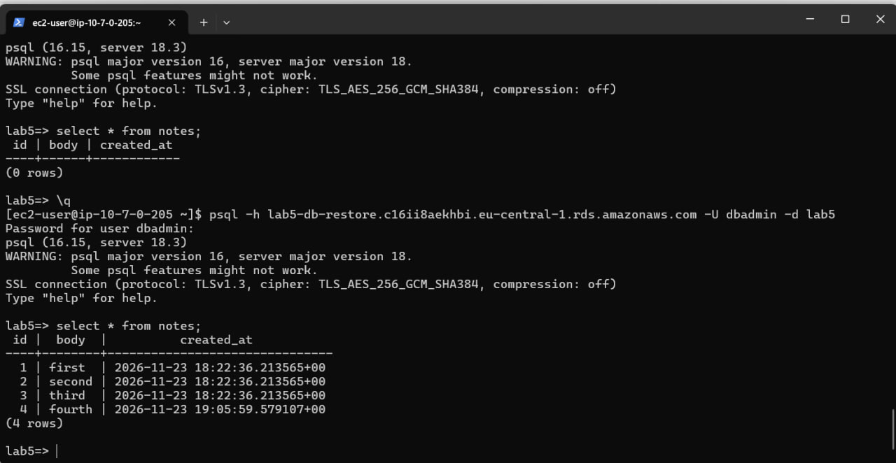

---

# Продвинутый уровень

## Задания 6-7. База приложения и ночная остановка

База `timecapsule-dev-rds`: PostgreSQL, класс `db.t4g.micro`, зона `eu-central-1a` (видно на скриншоте ниже, на вкладке Logs & events).

**Расписание `timecapsule-dev-rds-nightly-stop`** (EventBridge Scheduler), часовой пояс `Europe/Chisinau`. Для проверки на скриншоте задано время через несколько минут после создания (`10 11 * * ? *`, создано в 11:06). Потом выражение заменено на `0 23 * * ? *`:

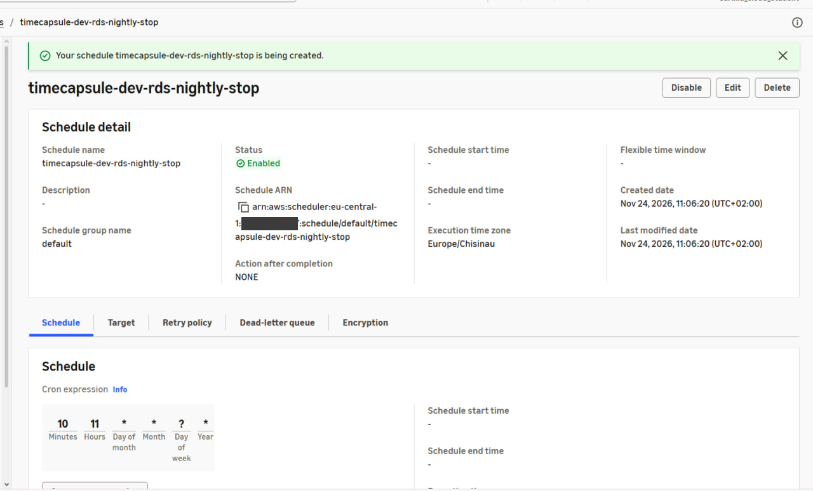

**Результат срабатывания:** база перешла в состояние *Stopping*:

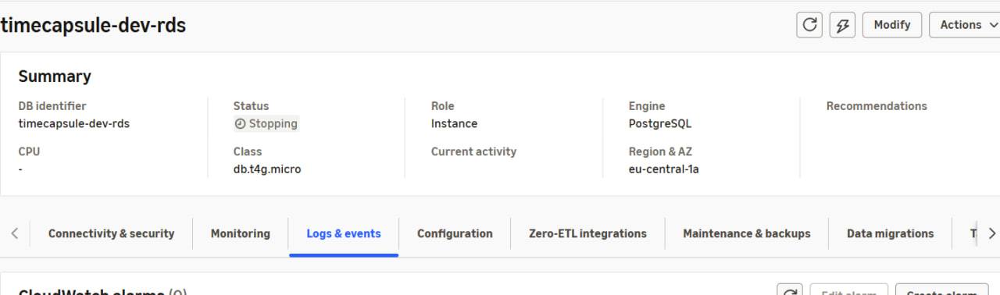

В Logs & events появилось событие `DB instance stopped` в 11:14 (UTC+02:00) после срабатывания расписания в 11:10:

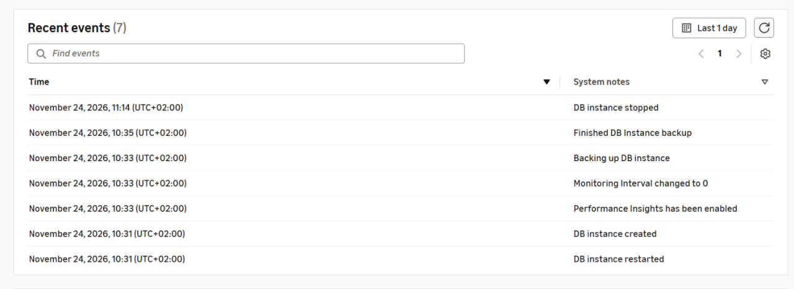

## Задания 8-10. Пользователь, перенос данных, переключение приложения

**Пользователь и база.** В RDS под `dbadmin` создан пользователь `timecapsule` (пароль задан через `\password`), выдана роль `GRANT timecapsule TO dbadmin;`, создана база `timecapsule` с владельцем `timecapsule`.

**Количество строк.** В старой базе на `db-server` (`db.timecapsule.internal` до переключения): `users` = **2**, `capsules` = **4**. Перед этим на скриншоте виден вывод загрузки дампа в RDS (`ALTER TABLE`, `CREATE INDEX`):

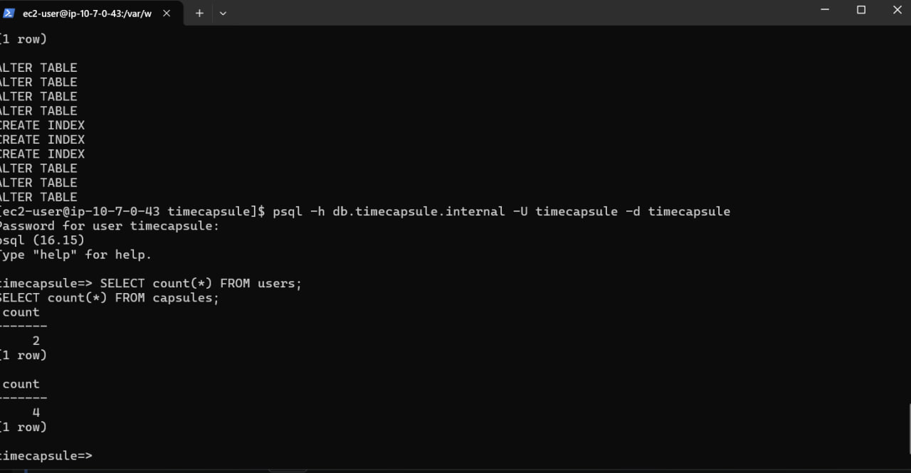

**Новая капсула в RDS.** После переключения приложения создана капсула `id = 6` («Проверяем пятую лабу»), она есть в таблице `capsules` в RDS (всего 5 записей: 4 перенесённые и 1 новая):

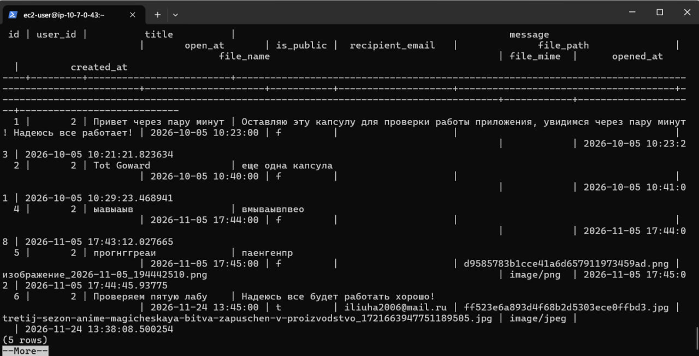

**Серверы без `db-server`.** `timecapsule-dev-db-server` в состоянии *Terminated*, остальные серверы (`web-server`, `app`, `bastion`) работают:

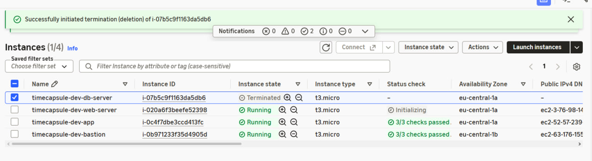

## Задание 11. Обслуживание базы

**/health во время перезагрузки.** Пока база недоступна, `/health` возвращает `"status":"error","db":"error"` и подсказку проверить `DB_HOST`, `DB_PORT`, `DB_NAME`, `DB_USER`, `DB_PASSWORD`:

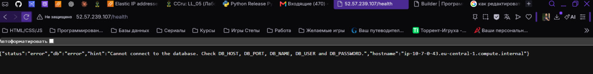

**События базы** (Logs & events): в 16:03 `DB instance shutdown` и `DB instance restarted` (перезагрузка), в 16:18 `DB instance stopped` (остановка базы вручную):

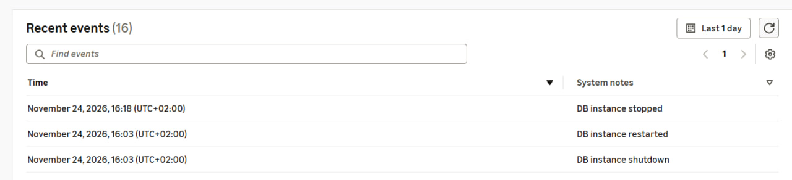

---

# Архитектура

Схема обновлена по сравнению с ЛР4: `db-server` заменён на RDS-экземпляр `timecapsule-dev-rds` в `private-a` (группа подсетей `timecapsule-dev-db-subnets` из `private-a` и `private-b`, Security Group `timecapsule-dev-rds-sg` с портом 5432 только от `web-sg`). Добавлены расписание EventBridge Scheduler и роль IAM для ночной остановки, запись CNAME `db` в приватной зоне Route 53. NAT Gateway убран: он был нужен только для обновления `db-server`.

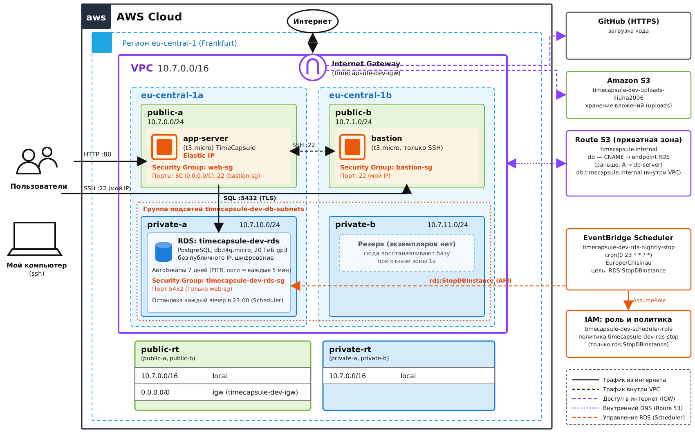

Решение о размещении базы: [ADR-0004: Размещение базы данных приложения](adr/0004-database-hosting.md).

---

# Ответы на контрольные вопросы

## Задание 1

**Почему для ограничения доступа удобнее использовать Security Group источника, а не его IP-адрес?** IP-адрес сервера может измениться (пересоздание или остановка и запуск экземпляра, замена сервера), и правило придётся переписывать. Правило со ссылкой на Security Group работает для любого экземпляра, которому она назначена, и сразу показывает, кому разрешён доступ.

**Зачем указывать две подсети, если база будет работать в одной зоне?** RDS требует, чтобы группа подсетей покрывала минимум две зоны доступности. Это нужно, чтобы AWS мог разместить реплику, резервный экземпляр Multi-AZ или восстановленную копию в другой зоне, не меняя сетевую настройку.

## Задание 2

**Как убедиться, что база принимает подключения только с нужного сервера?** Подключиться с веб-сервера (успешно) и попробовать с другого узла (например, с `bastion` или с компьютера): соединение не проходит. Дополнительно в настройках базы указано *Publicly accessible: No*, а endpoint разрешается только в приватный адрес `10.7.10.131`.

**Почему выбрана зона eu-central-1a?** Веб-сервер находится в `eu-central-1a`. Когда клиент и база в одной зоне, ниже задержка и нет платы за межзоновый трафик.

**От чего защищает deletion protection, а от чего нет?** Она не даёт удалить экземпляр базы через консоль или API, пока её не выключат. От удаления данных внутри базы (`DELETE`, `DROP TABLE`), от остановки и изменения параметров она не защищает.

## Задание 4

**Почему INSERT на реплике не выполнился?** Реплика находится в режиме восстановления (`pg_is_in_recovery() = t`): она только применяет изменения основной базы и принимает запросы на чтение, поэтому запись запрещена (`read-only transaction`).

**Чем реплика для чтения отличается от Multi-AZ?** Реплика асинхронная, доступна для чтения и нужна для разгрузки основной базы, но может отставать (`ReplicaLag`) и сама не подхватывает работу при отказе. Резервный экземпляр Multi-AZ синхронный, для запросов недоступен и служит для автоматического переключения при отказе основного.

## Задание 5

**Почему реплика не спасла данные?** Реплика повторяет все изменения основной базы, включая ошибочный `DELETE`, поэтому удаление через несколько секунд появилось и на ней. Реплика обеспечивает масштабирование чтения, а не защиту от ошибок. От них спасает резервная копия.

**Почему восстановление создаёт новую базу, а не откатывает старую?** Point-in-time restore берёт снимок и накатывает журнал изменений до выбранного момента, и результат разворачивается как отдельный экземпляр со своим endpoint. Старая база остаётся как есть: можно сравнить данные, достать нужные строки и не потерять изменения, сделанные после выбранного момента.

## Задание 6

**Какие параметры базы приложения вы выбрали бы иначе для рабочей системы?** Включил бы Multi-AZ (доступность при отказе зоны), не burstable-класс (`db.t4g.micro` ограничен по CPU и памяти), автоматическое увеличение хранилища и более долгое хранение резервных копий (14-35 дней), оставил бы deletion protection и финальный снимок при удалении. Также добавил бы мониторинг и алерты, хранение пароля в Secrets Manager и проверку сертификата сервера при подключении.

## Задание 7

**Зачем расписанию своя роль, если вы и сами можете остановить базу?** Расписание выполняется сервисом EventBridge Scheduler, а не от моего имени, у него нет моих учётных данных. Поэтому ему нужна роль, которую может принять только `scheduler.amazonaws.com`, и политика с нужным правом.

**Почему роль может остановить только одну базу?** В политике `timecapsule-dev-rds-stop` действие `rds:StopDBInstance` разрешено только для ARN `timecapsule-dev-rds`. Это принцип наименьших привилегий: при ошибке или компрометации расписание не сможет остановить другие базы.

## Задание 8

**Почему приложению нужен отдельный пользователь, а не dbadmin?** `dbadmin` имеет административные права на весь экземпляр (создание баз, пользователей, ролей). Если приложение скомпрометируют, злоумышленник получит все эти права. Отдельный пользователь `timecapsule` владеет только своей базой, а его пароль можно менять независимо от административного.

## Задание 10

**Почему не пришлось менять DB_HOST?** Приложение обращается к имени `db.timecapsule.internal`, а не к IP или endpoint. Я лишь заменил запись A (на `db-server`) на запись CNAME (на endpoint RDS), и приложение само начало работать с новой базой.

**Какие обязанности из ЛР3 перешли к AWS, а какие остались за мной?** К AWS перешли обновления СУБД и ОС (в окно обслуживания), автоматические резервные копии, работа с оборудованием и хранилищем, мониторинг состояния экземпляра. За мной остались сетевой доступ (Security Group), пользователи и права, схема и данные, шифрование соединения на стороне приложения, выбор размера, расписание остановки и расходы, запись в DNS.

## Задание 11

**Что показывал /health во время перезагрузки?** Ответ с `"status":"error","db":"error"` и подсказкой, что нет соединения с базой (скриншот выше). После окончания перезагрузки `/health` снова должен показывать успешное состояние.

**Изменился ли endpoint после остановки и запуска?** Нет, DNS-имя endpoint остаётся прежним (меняться может только IP-адрес за ним), поэтому запись CNAME и конфигурация приложения не менялись.

**Какую ошибку получает расписание, если база уже остановлена?** `StopDBInstance` для базы не в состоянии *Available* возвращает ошибку `InvalidDBInstanceState`. Состояние базы не меняется (она остаётся *Stopped*), расписание просто завершается ошибкой вызова.

---

# Устные вопросы (краткие ответы для защиты)

**Как проходит запрос от браузера до базы?** Браузер → Elastic IP `app-server` → Internet Gateway → Security Group `web-sg` (порт 80 открыт) → приложение → разрешение `db.timecapsule.internal` в приватной зоне Route 53 (CNAME на endpoint RDS, приватный IP) → маршрут `local` внутри VPC → Security Group `timecapsule-dev-rds-sg` (5432 только от `web-sg`) → TLS-соединение → аутентификация пользователя `timecapsule` в PostgreSQL.

**Чем репликация отличается от резервного копирования?** Репликация копирует все изменения почти сразу, в том числе ошибочные, и нужна для чтения или доступности. Резервная копия хранит состояние на момент времени и позволяет вернуться до ошибки.

**Как пережить отказ зоны eu-central-1a и сколько это будет стоить?** Автоматически: Multi-AZ и второй сервер приложения в другой зоне, это примерно вдвое дороже (≈ $26 вместо ≈ $13 за 3 месяца только за базу). Без этого: восстановить базу из резервной копии в `eu-central-1b`, переключить CNAME на новый endpoint, запустить приложение в другой зоне (простой десятки минут, потеря до ≈ 5 минут данных).

**Как вы решили проблему автоматического запуска базы через 7 дней?** Расписание EventBridge Scheduler останавливает базу каждый вечер в 23:00. Если AWS сам запустит базу после 7 дней остановки, ближайшее срабатывание расписания остановит её снова, и расходы ограничены менее чем одними сутками работы.
